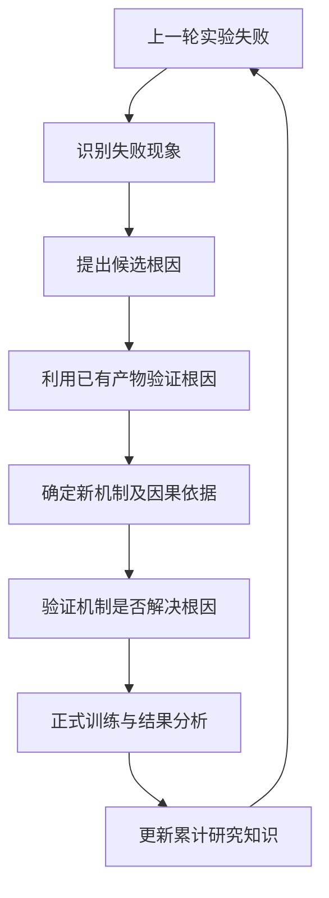
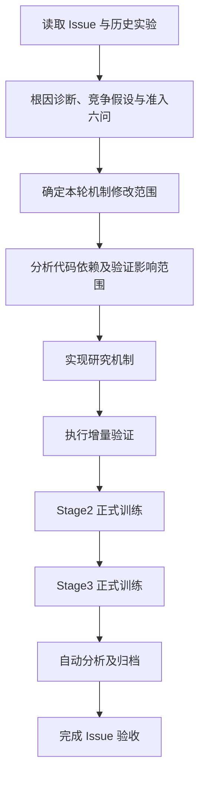

# 按 open issue 完成任务的闭环

> **最高优先级执行合同(owner 2026-11-27 直接指令;本 Skill 的本次修改由该指令授权)**
>
> 本合同的优先级高于本 Skill 其余全部条款;与其冲突的旧停止/不可行性规则以本合同为准。
>
> 1. **严格区分实验失败与任务失败。** `EXPERIMENT_FAILED` 绝不自动转化为 `ISSUE_BLOCKED`、
>    `BLOCKED` 或关闭理由。状态与必须执行:
>
>    | 状态 | 必须执行 |
>    |---|---|
>    | 当前实验失败 | 分析失败根因,设计并执行下一轮实验 |
>    | 参数组合失败 | 探索其他合法参数组合 |
>    | 当前机制存在缺陷 | 在授权范围内修复机制 |
>    | 历史候选全部未达标 | 继续寻找新的可行候选 |
>    | 外部资源/授权阻塞 | 保存进度,明确报告阻塞 |
>    | Issue 全部验收满足 | 最终验收并关闭 Issue |
> 2. **强制迭代闭环。** 完成 Issue 是持续闭环,不是一次实验;每轮失败必须产出下一轮的
>    具体研究假设与执行方案并直接执行已授权的操作,不等待用户逐轮确认:
>
>    ```mermaid
>    flowchart TD
>     A["读取 Issue 验收条件"] --> B["设计并执行实验"]
>     B --> C["验证全部指标"]
>     C --> D{"是否全部达标"}
>     D -->|否| E["定位失败根因"]
>     E --> F["设计针对性改进"]
>     F --> B
>     D -->|是| G["归档、推送、关闭 Issue"]
>    ```
> 3. **禁止伪造不可行性证明。** 有限测试集合的枚举只能证明
>    `∀x∈X_tested: Pass(x)=False`;它不能证明 `∄x∈X_allowed: Pass(x)=True`。
>    禁止根据有限实验、参数扫描失败、负相关结果或历史候选集合宣布研究方向不可行并停止。
>    `X_tested` 的结果是知识记录,不是终止证据;只有**整个合法搜索空间**的可执行证明,或
>    owner 明确修改验收条件/授权终止,才能改变 Issue 的判据或停止迭代。
> 4. **退出前强制检查。** 每次准备结束任务前逐条回答:Issue 是否已 CLOSED?所有验收条件是否满足?
>    是否仍有未验证且符合授权范围的研究假设?是否存在可继续执行的诊断、参数调整或机制改进?
>    是否真正存在无法自主解决的外部阻塞?**只要 Issue 未完成且仍有合法可执行的下一步,必须继续工作**;
>    不得以总结报告、负结果或请求用户选择方案作为任务结束。
> 5. 例外仅限真正的外部资源、权限或不可恢复错误;不得把"这一轮失败"翻译成"任务不可完成",
>    也不得用无信息重复实验维持运行。每轮必须产生可验证的知识增量。

## 前置原则(先于一切步骤)

> 研究机制的实现错误由当前 Issue 修复;公共 Infra 的缺陷由独立 Infra Issue 处理。
> 研究迭代不得演变为基础设施开发任务。持续执行义务仅适用于当前 Issue 授权范围内的工作。

科研严谨性不降级:数学契约、独立参考实现、确定性测试、变异测试、分模块梯度验证、结论复核
仍然全部必做。要减少的是**重复工程工作**(反复搭建 Infra、重复全量检查、重复编写复算器),
不是验证强度。

## INFRA_MODE(开始前必须确定,默认 FROZEN)

| 模式 | 允许操作 |
|---|---|
| `FROZEN`(默认) | 只修改研究机制与机制专属测试;复用已有 Infra、资产与既有分析/评估/归档接口 |
| `BUILD` | 允许建设或修复 Infra,但必须由 **Issue 正文明确授权** |

判定与记录:

1. Issue 没有明确写出"允许新建/修复公共 Infra"→ 一律 `FROZEN`。
2. 只有引用 Issue 原文的授权句才可切到 `BUILD`;把该句、模式、判定时间写进 `RUN_LOG.md` 与 `PROGRESS.json`。
3. 同一 Issue 中途不静默换模式;需要切换时先在 Issue 评论说明并等 owner 确认。
4. 本 Skill、`CLAUDE.md`、公共准入规则在任何模式下都不由研究迭代修改;要改就走独立 Infra Issue。

### FROZEN 模式的文件修改边界

| 内容 | 是否允许修改 |
|---|---|
| 候选 GNN、门控网络、量化器及 Loss | 允许 |
| 候选机制专属测试 | 允许 |
| 实验合同(`CONTRACT.md`)、`RUN_LOG.md`、`DIAGNOSIS.md`、`HYPOTHESES.json`、日志、报告、`VERDICT.md` | 允许 |
| `tools/iteration/` | 禁止 |
| 公共训练框架(`tools/research/stage2/`、`stage2_RQ-VAE/baseline/`、Stage3 训练入口) | 禁止 |
| 公共评估器、复算器与归档器 | 禁止 |
| `assets/` 既有数据及其生成工具 | 禁止 |
| 公共准入规则、Skill、`CLAUDE.md` | 禁止 |

正常运行的输出(日志、checkpoint、凭据、报告、台账、缓存条目)按既有 API 生成,不属于新 Infra。

### Infra 完整性检查(合并检查点,不做每阶段双检)

一轮只在三个节点记录并重算下列公共组件的 `path:sha256`:
①**本轮开始**;②**正式训练派发前**;③**归档/关闭前**。相邻阶段共用上一次结果,不重复检查。
组件范围:`tools/iteration/`、`tools/research/stage2/`、`tools/research/verification/`、
`assets/manifest.json`、Stage3 训练入口、`CLAUDE.md`、本 Skill。指纹用
`tools/iteration/depgraph.py` 的导入闭包计算,**禁止为此新写检测工具**。
发现未经授权的变化:停止推进,按 §1.1 记录,并按 §6.1 处理。
运行期正常产物(日志、checkpoint、receipts、报告)不计入 Infra 变更。

## 根因驱动迭代(每轮机制设计前强制)

> **目的不是增加测试数量,而是保证每轮实验都积累有效的研究知识。**
> 机制设计之前必须先回答"上一轮为什么失败",而不是直接换参数、换 Loss 或换监督层级。



根因诊断优先复用已有 checkpoint、SID、梯度记录、`stage2_metrics`、Stage3 预测与
`tools/iteration/analysis.py` / `replay.py` 等既有接口;**不允许为了诊断而默认重新进行完整训练**。
低成本验证包括:冻结 checkpoint 的前向探测、SID 结构/碰撞分析、已有梯度记录的复核、
小批量表征统计、对既有预测的重新归约。只有这些证据确实无法区分假设时,才允许按既有准入路径做
必要的最小训练;必须在 `DIAGNOSIS.md` 写明为什么更低成本的手段不足。

### 六项强制规则

| 规则 | 强制要求 |
|---|---|
| 现象与根因分离 | 不允许直接把 Recall 下降、碰撞率过高、量化误差偏大等现象认定为根因;现象只是待解释的观测 |
| 竞争性假设 | 至少提出两个可区分的解释(或一个主假设加一个显式 null/平凡解释),不能只验证 Agent 最初提出的解释 |
| 根因证据 | 每个候选根因必须有支持或排除它的实际测量:命令、产物路径、数值/分布、sha256;没有测量只能标 `UNTESTED` |
| 机制针对性 | 新机制必须逐条说明它作用于哪个根因、通过什么计算通路、为什么该通路会改变该根因;不能只写"加入某种几何/正则" |
| 局部验证 | 正式训练前尽可能用低成本实验验证机制产生了预期作用:开关两侧的中间量、梯度、排序/分布变化;不要求证明 Recall 一定提高 |
| 知识累积 | 每轮更新已证实、已排除、尚未验证的假设;下一轮不得重复已被证伪的机制,除非有新的证据或实质性机制变化 |

**禁止**:仅因为上一轮效果不好就修改超参数、变换监督层级或更换 Loss。任何这类修改必须先有新的证据
说明它作用于一个具体根因;否则视为无方向尝试,不得进入正式训练准入。

### 强制研究记录(不开发新 Infra)

每轮新增或更新以下文件,全部是普通 Markdown/JSON 证据,不新增工具、不新增服务:

| 文件 | 必须记录的内容 |
|---|---|
| `DIAGNOSIS.md` | 失败现象、候选根因、竞争性解释、支持/排除证据、低成本验证结果、仍不确定的部分 |
| `HYPOTHESES.json` | 历史假设及其当前状态、证据路径、来源轮次/Issue、重新打开原因 |
| `CONTRACT.md` | 新机制、针对的根因、因果通路、可证伪预测、判定指标与方向 |
| `VERDICT.md` | 根因是否解决、机制是否有效、推荐指标是否改善、哪些假设被证实/排除/仍不确定 |

`HYPOTHESES.json` **必须跨轮次继承,不能每轮重新建立**。推荐结构:

```json
{
  "schema": "genrec.hypotheses/1",
  "issue": 259,
  "inherited_from": "results/research/issue258/HYPOTHESES.json",
  "hypotheses": [
    {
      "id": "H1",
      "statement": "上一轮失败的原因是……",
      "status": "SUPPORTED",
      "evidence": ["results/research/issue259/diagnosis/H1_probe.json"],
      "origin_issue": 258,
      "opened_round": "r04",
      "last_update": "2026-11-26",
      "reopen_reason": null
    }
  ]
}
```

本轮文件放在 `results/research/<issue>/`。若该 Issue 使用 `rounds/<round>/`, `DIAGNOSIS.md` 与
`VERDICT.md` 可随轮次放在 round 目录,但 `HYPOTHESES.json` 必须保留在 Issue 根并跨轮继承。

状态只能取以下五种:

| 状态 | 含义 |
|---|---|
| `UNTESTED` | 尚未验证,或没有可引用的测量 |
| `SUPPORTED` | 现有证据支持,但尚未通过机制验证 |
| `REFUTED` | 现有证据否定;再次探索必须给出新证据或实质性机制变化 |
| `INCONCLUSIVE` | 证据不足以判断,必须写明缺什么测量 |
| `RESOLVED` | 针对该问题的修改已通过验证,根因在该轮被解决 |

继承规则:

1. 同一 Issue 的后续轮次在原文件上更新,保留全部历史条目,禁止 reset。
2. 新 Issue 继续既有研究方向时,复制最近的相关 `HYPOTHESES.json` 并填写 `inherited_from`;
   只允许新增/更新状态,不得丢弃旧条目。
3. 把 `REFUTED` 重新打开为 `SUPPORTED`/`UNTESTED` 时,必须在 `reopen_reason` 写明新证据或机制差异。
4. 每条假设的 `evidence` 为空时只能标 `UNTESTED`;`SUPPORTED`/`REFUTED`/`RESOLVED` 必须有可复算证据。

### 正式训练前准入六问

在 Stage2 正式训练之前,Agent 必须逐条回答,答案写进 `DIAGNOSIS.md`(或同轮 `RUN_LOG.md`),
缺任何一条即视为未完成根因准入:

1. 本轮究竟要解决哪个具体问题?
2. 有什么证据表明这是导致上一轮失败的原因?
3. 为什么新的机制能够作用于这个原因?
4. 与之前失败的机制相比,本轮存在什么实质性区别?
5. 使用什么指标判断该问题是否得到解决?
6. 如果本轮仍然失败,能够获得什么新的研究知识?

不要求保证每轮 Recall 都会提高,也不要求在训练前证明只有一个根因;但必须保证本轮实验能够区分
有意义的竞争性解释,而不是无方向地尝试。若六问的答案只能落到"再试一个 Loss/超参数",本轮不得启动训练。

### 与现有流程的接口

- 根因诊断必须在冻结 `CONTRACT.md` 之前完成;`CONTRACT.md` 增加"针对的根因 / 因果通路 /
  可证伪预测 / 判定指标"四段。
- 执行流程中"确定本轮机制修改范围"之前必须先完成本模块;未完成不得进入实现与验证。
- 训练后的 `VERDICT.md` 必须回答:根因是否解决、机制是否有效、推荐指标是否改善、知识增量是什么;
  只写 Recall 数字不算完成。
- 本轮结束后更新 `HYPOTHESES.json`;下一轮选题必须引用其中仍 `SUPPORTED`/`UNTESTED` 的假设,
  或说明为什么重开某个 `REFUTED` 假设。
- 保持不变:单 Agent 执行、Infra 冻结(`FROZEN`)、复用冻结 TIGER 基线、增量验证与收据复用、
  不做多种子实验、不为诊断新建 Infra。

> **每轮迭代必须产生可验证的知识增量。不得重复探索已被证伪的机制,除非存在新的证据或实质性机制变化。
> 评价一轮实验不仅看最终 Recall,还要判断它是否解决了已发现的问题、排除了错误假设,并缩小了下一轮的搜索范围。**

## 执行流程(根因诊断前置)



A2 未完成或六问缺答案时,不得进入 B;诊断记录与假设状态按上一节写入 `DIAGNOSIS.md` 与
`HYPOTHESES.json`。

禁止在每轮迭代中重新建设已有 Infra、重新训练 TIGER 基线或无条件重复执行所有历史测试。

按 Infra 完整性检查的三个检查点执行(开始、训练派发前、归档/关闭前),相邻阶段共用结果。
遇到 Infra 错误时,只允许用**已有接口**重新执行或恢复;不得临时编写新的框架工具,不得绕过准入、
不得伪造结果。

## 增量验证与重复执行禁令(默认)

> **每一项重复执行的操作,都必须能够说明本轮发生了什么变化,使得之前的验证证据不再有效。
> 如果无法说明,则不得重复执行。**

这条原则优先于"多跑一遍更保险":没有失效理由的重跑是浪费,也必须记录为一次无理由重复。

### 变更范围 → 验证范围(按本轮实际修改,而不是按历史清单)

| 修改内容 | 必须验证 | 可以复用的历史验证 |
|---|---|---|
| Loss 函数 | 数值正确性、梯度传播、相关集成测试 | 未受影响的数据资产测试 |
| 门控网络 | 权重计算、梯度、码字分配 | 图数据构建测试 |
| GNN | 消息聚合、梯度、计算性能 | 未受影响的 Stage3 模型/测试 |
| 曲率距离 | 距离数值、数值稳定性、量化结果 | 未受影响的图资产测试 |
| 公共训练框架(`BUILD` 授权时) | 完整回归测试 | 根据实际依赖判断 |
| 仅修改超参数 | 参数合法性、必要的训练准入 | 未受影响的单元测试 |
| 仅修改文档/报告/证据文本 | 不触发任何计算证据;只更新引用哈希 | 全部计算证据 |

历史验证只有在**相关代码、依赖、数据资产和执行环境**均未发生影响其有效性的变化时才允许复用。
无法确定影响范围时,必须扩大验证范围(先按更大闭包实跑,再收窄)。

### 强制执行约束

| 规则 | 强制要求 |
|---|---|
| 日志持久化 | 所有测试/训练命令从启动时就保存完整日志、命令、开始时间、退出码与版本信息(python、torch、GPU);**预计超过 60 秒的命令启动前必须先确认输出路径存在且可写**。未落盘的运行视为没有执行过,不得引用其输出 |
| 禁止重复执行 | 已具有有效证据(指纹 + 收据 + 日志 + 退出码)的测试不得无理由重跑;重跑必须在 `CHECK_k.md` 写明"哪一处变化使旧证据失效" |
| 性能测试 | 只有计算路径或性能相关配置发生变化时,才执行完整的 60 epoch 基准;仅测试/文档/证据改动不得重跑 benchmark |
| 梯度检查 | 只检查受到本轮机制影响的模块及相关梯度传播路径;未受影响的模块复用其分模块收据 |
| 变异测试 | 只重新执行受到修改影响的变异;原有的、闭包未变的变异记录保持有效 |
| Infra 冻结 | 研究迭代期间禁止新增、修改基础设施;缺失或故障按 §1.1 记录,按 §6.1 处理 |
| 基线复用 | 直接使用已经冻结的 TIGER 实验结果;禁止重训 TIGER 基线 |
| 结果分析 | 调用已有自动化分析工具(`tools/iteration/analysis.py`、`replay.py`、`report.py`),避免手工重复统计 |
| 失败处理 | 根据失败原因做局部修复,只复验受影响范围,不重启整个流程 |
| 时间记录 | 自动记录每个执行阶段的实际耗时及重复执行原因(`TIMELINE.jsonl` / `CHECK_k.md`) |

### 时间预算(用于发现异常开销,不是跳过验证的借口)

| 执行阶段 | 预算 |
|---|---:|
| 阅读 Issue、分析历史结果 | 3 分钟 |
| 研究机制实现 | 10 分钟 |
| 增量验证及训练准入 | 7 分钟 |
| Stage2 | 34 分钟 |
| Stage3 | 42 分钟 |
| 自动分析及归档 | 4 分钟 |
| **总计** | **100 分钟** |

超出预算时,Agent 必须记录具体原因(首次 import、冷缓存、真实故障、外部排队等),并区分
"必要验证"与"重复执行";不得为了达标而跳过必要验证,也不得把异常开销当作正常。

## 铁律:在授权范围内推进到终止状态

一旦开始执行 Issue,Agent 必须在当前 Issue 的授权范围内持续执行,直到
`gh issue view <N> --json state` 返回 `CLOSED`(COMPLETED),或按 §6.1 报告
`INFRA_BLOCKED` 并保持 OPEN。

**机制范围内不得以下列任一理由结束任务:**

- 任务量大、剩余步骤多;
- 上下文或当前轮次预算不足;
- 训练耗时长,或训练仍在运行(应当轮询等待,而不是收尾);
- 机制测试失败;
- 机制实现错误或存在 bug;
- 任何「这一轮做不完」的判断。

**只要授权范围内还存在可执行任务**(改机制代码、修机制 bug、加机制测试、跑检查、等训练、写证据、评论 issue),
就必须继续做。`PROGRESS.json` 只是断点文件:用于外部强制中断之后的恢复,**不构成主动退出条件**;
写完之后必须继续执行。

允许停止的情形只有三种(见 §6.2):

1. `gh issue view <N>` 返回 `CLOSED`(COMPLETED,或 Issue 明确授权时的 BLOCKED);
2. 用户明确取消,或外部系统强制中断(进程被杀、机器故障等不可控事件)——恢复后仍然继续;
3. `INFRA_BLOCKED`:公共 Infra 存在可复现、不可用既有接口恢复的故障,已按 §6.1 留下证据并评论;
   **Issue 保持 OPEN**,等待 owner 决定。该状态只允许在授权范围内确实无可执行下一步时使用。

一个 issue 只有在**它的验收条件逐条被证据满足**时才算完成。本 skill 把这个过程固定为
`读 issue 与历史实验 → 确定本轮机制修改范围 → 分析代码依赖与验证影响范围 → 实现机制 →
增量验证 → Stage2 → Stage3 → 自动分析归档 → 完成验收`;任何一步不满足,回到它应该在的那一步,
不允许跳步,也不允许"差不多"。

**训练不是固定步骤**:跑不跑由 issue 的验收条件决定(见 §4)。

**每个关键节点必须立刻评论到 issue,然后继续干活。** 评论与断点都不是收尾:
它们必须落到仓库和 issue 上,但做完就继续下一步。

| 会被误当成"该停了"的瞬间 | 必须改成 |
|---|---|
| 一轮检查有 FAIL | 机制错误继续修;公共 Infra 问题只记录(§1.1),不得改框架 |
| 某条 `NOT_RUN` | 那就是当前要做的活(在授权范围内),做完再判 |
| 训练在跑 | 轮询(≤60 秒/次)直到出结果,然后进 §5 |
| 训练失败/指标低 | 按 §4 分类回对应步骤,或按 §5 出负结论并写进 `VERDICT.md` |
| 遇到需要授权的例外(如 `git push --force`) | 该例外单独处理,但 issue 的其余部分继续推进 |
| 想先汇报进度再继续 | 先 `gh issue comment` 贴该节点证据,再用 `out://` 说明,然后**继续干活** |
| **遇到阻塞或失败** | 机制错误→继续修;公共 Infra→§6.1(默认保持 OPEN 报告) |
| 想让流程通过而修改公共框架 | **禁止**;记录为 Infra 故障(§1.1) |
| 本轮预算/上下文不足、任务还剩很多 | **不是结束理由**:继续做,必要时先写断点再继续 |
| 测试失败 / 实现报错 | 机制范围内那是当前要做的活:定位、修、重跑,不要结束 |
| 训练还在跑 | 轮询等待,或先推进不依赖它的部分,不得收尾 |
| 参考实现或单模块测试通过 | 不等于生产代码修好,也不等于训练入口正确(§6.5) |

终止状态见 §6.2:**COMPLETED**(CLOSED)、**BLOCKED**(仅 Issue 授权时,CLOSED)、
**INFRA_BLOCKED**(默认,保持 OPEN 并报告)。没有第四种状态。

**工作尚未完成,不等于工作无法完成。** 任务量大、训练耗时长、上下文或单轮预算不足、代码还没写完、
可修复的机制 bug —— 都不是阻塞,也都不是结束理由。把公共 Infra 故障当成机制 bug 去修框架,
或者反过来把机制 bug 当成 Infra 阻塞,都是本 skill 明令禁止的。

## 强制机制(七项,单 Agent 执行时全部必做)

单 Agent 没有人可以互相复核,所以把"复核"固化成七项有证据落点的机制。每一项都必须留下文件,
只写在对话里不算做过;任何一项缺失,§3 的检查循环不得判 PASS。

| 机制 | 单 Agent 执行要求 | 证据落点 | 缺了算什么 |
|---|---|---|---|
| **数学契约** | 编码前冻结公式、输入输出、张量形状与 dtype、边界条件(零范数、空集合、不可达、除零、重合点)、数值容差。实现只能服从契约;确需偏离时先改契约并记录日期与理由 | `CONTRACT.md` + 逐条断言 | 视为未开工 |
| **原论文对照** | 逐模块核对论文的章节与公式编号,以及官方实现;不一致的地方写明"论文怎么写 / 官方实现怎么写 / 我们怎么选 / 为什么" | `CONTRACT.md` 的对照表(列:模块 / 论文位置 / 官方实现 / 本项目取舍) | 视为未核对 |
| **独立参考实现** | 换**数学路径**或换可信库,禁止 import 生产模块。把 PyTorch 公式逐行翻译成 NumPy **不算独立**:必须走另一条推导,如闭式解 vs 迭代、暴力枚举 vs 向量化、另一种恒等式、`geoopt`/`scipy` 的成熟实现;并在契约里写明二者为何独立、在什么容差内一致 | `reference.py` + `tests/test_reference.py` | 视为自证 |
| **确定性测试** | 用手算得出正确答案的极小输入:2–3 个节点的图、单层码本、退化边界。期望值**写死在测试里**,不是运行时算出来的 | `tests/test_known_answers.py` | 视为无判据 |
| **变异测试** | 故意注入典型错误:off-by-one、符号翻转、错误的 reduction、漏 mask、错误的系数、把 STE 换成直通。每个变异必须被**指定的断言**抓到,并记录"变异 → 哪条断言失败";崩溃、导入错误、超时都不算 | `tests/test_mutation.py` + `MUTATIONS.md` | 视为测试无检测力 |
| **分模块验证** | 用**实际训练用的 loss** 与真实数据逐模块检查:前向输出、梯度是否存在/是否为 None/是否为零、参数是否真的更新。用临时构造的简单 loss 证明"参数能动"不算验证;只看总 loss 也不算 | `MODULE_CHECKS.json`(每模块一行) | 视为未验证 |
| **结论复核** | 训练结束后重新读源码、从原始产物**重算**头条指标,确认 `REPORT.md` 里的数字与重算一致;确认结论没有超出数据(如把样本内说成泛化) | `VERDICT.md` 的"复核"段 + 既有复算接口的输出 | 视为结论未成立 |

变异测试的最低要求:不少于 5 个变异,覆盖数值(系数/符号)、结构(漏 mask/错 reduction)、
路由(梯度是否到该到的模块)三类。**每个有效变异都必须被抓到,并且是被指定的断言抓到**;
程序崩溃、导入错误、异常退出都不算捕获 —— 那只说明变异写坏了,不说明测试有检测力。
**全部被抓到是目标,不是可疑信号。** 需要补强的是这两种情况:某个变异只能靠"崩溃"暴露,
或没有任何断言能定位到它。

## 测试本身的正确性(六条)

1. **参考实现要有数学独立性**:换推导或换库,不是把 torch 公式抄成 numpy(见上表)。
2. **变异必须被指定断言抓到**:崩溃不算捕获;记录"变异 → 失败的那条断言原文"。
3. **优先测生产路径上的函数**:训练实际调用的那个函数才是被测对象;只测新写的参考函数等于没测生产代码。
4. **分模块梯度必须用实际训练 loss**:用临时 loss 证明参数可更新,不证明训练时梯度会到该到的地方。
5. **覆盖三类输入**:正常输入、边界输入(球边界、空邻域、单元素)、退化输入(零向量、常数、重复边)。
6. **训练前后各检查一次接线**:开训前确认实际调用链与冻结契约一致(哪层用哪个曲率、梯度到哪个模块、
   哪个系数进 loss);训练后再核对一次,防止训练期改动让接线漂移。

## 执行顺序

1. 阅读 issue 与历史实验,冻结验收清单(§0;`RUN_LOG.md`),确定并记录 `INFRA_MODE`。
2. **完成根因诊断与竞争假设**(上一节):写 `DIAGNOSIS.md`、继承并更新 `HYPOTHESES.json`,
   逐条回答正式训练准入六问。未完成不得确定机制范围,更不得启动训练。
3. **先读 `/home/wlia0047/ar57/wenyu/GeneRec/assets`**:需要的 Infra 资产已存在就直接读取(按哈希引用)
   (§1.0)。`FROZEN` 下**禁止**新建或重建资产;确实缺失时记录为 Infra 故障(§1.1)。
4. **若开始新 Stage2 机制,先归档全部旧机制,再复制冻结基线、开展新机制探索**(§1.0a);
   之后冻结**数学与数据契约**(`CONTRACT.md`,含针对的根因、因果通路、可证伪预测、判定指标)。
   非新机制任务不搬动当前机制。
5. **分析依赖闭包与验证影响范围**:用 `tools/iteration/depgraph.py` 生成本轮验证计划,
   标明实跑项与 `reused:<指纹>` 项;无法确定影响范围时扩大,不得无差别重跑全部。
6. 先写**独立参考实现**与**确定性测试**(含手算期望值),再写正式代码(§2)。
7. 实现生产代码,只跑受影响范围内的确定性测试与参考一致性测试。
8. **故意引入典型错误**,只在受影响的模块/路径上验证测试的检测能力;不通过先补测试。
9. 用真实数据**逐模块验证受影响的模块**及其梯度传播路径(§3)。
10. 全部准入检查与低成本机制验证通过后才启动正式训练;性能基准按 §4 的增量规则执行。
11. 训练结束后**重新审查源码、指标计算与实验结论**,用既有复算接口从原始产物重算头条指标(§5);
    在 `VERDICT.md` 更新根因是否解决与知识增量,归档证据并关闭 issue(§6)。

顺序不可交换:先根因诊断再定机制,先查 `assets/` 再谈资产,先归档旧机制再复制基线与探索新机制,
先定影响范围再验证,先参考实现后生产代码,先变异测试后正式训练,先结论复核后关闭。取消的是
**重复建设与无理由重跑**,不是**顺序要求**或**验证强度**。

## 进度必须回写到 issue(不是只写本地)

每完成一个关键节点、或得到一条关键结论,**立刻**在 issue 下 `gh issue comment <N> --body-file <文件>`,
然后才继续。本地文件(`RUN_LOG.md`/`CHECK_k.json`/`VERDICT.md`)是证据,issue 评论是给别人看的结论;
只写本地而不评论,视为这一节点没交付。

必须评论的节点:

| 节点 | 评论里至少写 |
|---|---|
| 冻结验收清单后 | 清单条数、正文 sha256、`INFRA_MODE` 判定及授权原文(或"未授权→FROZEN")、**是否需要训练及依据** |
| Infra 校验完成 / 出现 Infra 故障 | **`assets/` 复用了哪些资产(`path:sha256`)、哪些组件做了哈希基线**;缺什么、影响了哪一步、用哪个既有接口尝试过、是否可恢复。`FROZEN` 下不写"修复进度",写"故障与影响" |
| 根因诊断完成 / 正式训练准入六问 | 现象、候选根因、竞争性解释、支持/排除证据、`SUPPORTED`/`REFUTED`/`UNTESTED` 计数、`DIAGNOSIS.md` 与 `HYPOTHESES.json` 路径 |
| 每条 `C` 从 FAIL→PASS,或出现新的 FAIL | 编号、命令、关键输出、证据文件路径;复用项写 `reused:<指纹/收据>` |
| 每轮检查结束(`CHECK_k`) | 本轮 PASS/FAIL/NOT_RUN 计数、复用项与实跑项、FAIL 的具体证据、下一轮要修什么 |
| 训练启动 / 训练结束 | run 名、pid、epoch 范围、最终碰撞率与产物路径 |
| §5 结论对账 | 逐条对照表、整体判定、`VERDICT.md` 路径 + commit sha |
| 每轮知识更新 | 根因是否解决、机制是否有效、推荐指标变化、假设状态迁移、下一轮方向 |
| §7 不可满足判定 | 互斥规模、计算脚本路径、为什么该主张在预算内不可满足 |
| Infra 完整性前后对比 | 公共组件 `path:sha256` 基线、结束时的重算值、变更清单(应为空) |
| 关闭 issue | 结果、证据路径、commit sha(就是 `gh issue close` 的 comment) |

评论用 ``gh issue comment <N> --body-file results/research/issue<N>/COMMENT_<序号>.md``,文件本身入库,
保证"issue 上说了什么"和"仓库里有什么证据"一一对应。一次评论只讲一件事,附上路径与数字,不要复述猜测。

## 0. 读 issue 并冻结验收清单

```
read issue://<N>                 # 或 gh issue view <N> --json number,title,body,state
```

把 issue 正文里的验收条件**逐条原文抄录**成清单 `C1..Cn`,每条补齐四件事:

| 字段 | 要求 |
|---|---|
| 判据 | 指标名/公式/文件位置,能机械复算 |
| 阈值 | `>`、`<`、`==` 与数值(例如 Stage3 `test_R@10 > 0.065`) |
| 数据 | 用哪份训练/验证/测试输入,路径 + sha256 |
| 口径 | 谁算、在哪算、输出写哪里 |

同时把 `issue #N`、标题、正文的 sha256 记进 `results/research/issue<N>/RUN_LOG.md`,写下
**本轮是否需要训练及依据**(判定规则见 §4),并写下 `INFRA_MODE` 的判定与依据:

- Issue 有"允许新建/修复 Infra"的明确授权句 → `BUILD`(引用原句);
- 其他情况(包括"只使用既有 Infra""严禁开发新 Infra")→ `FROZEN`。

之后每轮检查都以这份清单为准;issue 正文在本轮中途被改过时,重新冻结并记录差异。

同时写下**本轮机制修改范围**:哪些候选模块、哪些机制测试、哪些证据可能变化。这份范围是 §3 影响
分析的输入,也是判断"哪一处变化使旧证据失效"的依据;范围为空(纯文档/分析任务)时,不得重跑任何
计算证据。修改范围与验证计划一并写进 `RUN_LOG.md`。

**issue 缺少可判定条件时不许开工**:先在 issue 下评论列出缺口,等 owner 补齐。

新 Stage2 机制任务先完成 §1.0a 的旧机制归档,再写 `CONTRACT.md`;其他任务在冻结清单时写。
契约包括每个待实现模块的公式、输入输出形状与 dtype、边界条件(零范数、空邻域、不可达、除零、重合点)、
数值容差,以及该模块的论文/官方实现对照行。契约先于代码。**实现与契约冲突时默认改实现**;
只有当契约本身写错、或研究定义确需变更时才改契约,
并且必须由 owner 确认、记录日期与理由。**禁止为了让实现通过而放宽契约** —— 那是在改正确答案。

## 1. infra 校验(复用优先,研究迭代不建 Infra)

### 1.0 **先查 `assets/`,按模式处理缺失**(第一步,先于本节任何其他动作)

所有 Infra 资产都放在仓库根的 `assets/`(CLAUDE.md §3a)。**本节的第一步永远是读取它**,
而不是重新计算已经存在的东西:

```bash
ls -la /home/wlia0047/ar57/wenyu/GeneRec/assets
cat  /home/wlia0047/ar57/wenyu/GeneRec/assets/manifest.json   # 若存在
```

| `assets/manifest.json` 的状态 | `FROZEN`(默认) | `BUILD`(Issue 明确授权) |
|---|---|---|
| 覆盖本次 issue 需要的全部资产 | **直接读取使用**。逐项核对 `sha256`、`coverage`、`use`;禁止重新计算、重新生成、复制或改名;在 `INFRA.md` 里写"引用 `assets/<name>`(sha256 …)" | 同左 |
| 只覆盖一部分 | 已有部分直接读取;缺失项**不得创建**,写进 `INFRA_FAULTS.md`(需求 → 缺失项 → 可用的既有替代 → 影响),按 §1.1 判定能否用既有路径继续 | 已有部分直接读取;只对授权点名且确实缺失的项新建,新文件写进 `assets/` 并登记 manifest/coverage/README |
| 不存在 / 覆盖不到 | **不得创建**;`INFRA_FAULTS.md` 记录并按 §1.1 处理 | 只有在 Issue 明确授权且指名要建时才创建,并且只创建到 `assets/` |

`assets/` 下已存在的二进制**禁止覆盖或手工改写**(CLAUDE.md §17d);需要新版本时写新目录并更新 manifest。
复用既有资产时**按不可变哈希引用**,不复制、不重复上传。

**研究迭代禁止**为了跑通一次实验而新建数据资产、缓存、评估器、控制器、launcher、状态机、
依赖检测器或报告生成器;这些属于公共 Infra,缺陷走独立 Infra Issue。

### 1.0a 新机制探索前必须先归档全部旧机制

**每次开始一个新 Stage2 机制都必须执行,不是首次执行一次。** 在复制基线代码或开展新机制设计、
参考实现、生产实现之前,先把 `/home/wlia0047/ar57/wenyu/GeneRec/stage2_RQ-VAE/` 顶层
所有已有的旧机制目录,完整移动到 `/home/wlia0047/ar57/wenyu/GeneRec/stage2_RQ-VAE/_archive/`。

1. **保留 `baseline/` 与 `_archive/` 原位**:不移动、不改写冻结基线,不递归搬动已有归档。
2. 先确认旧树没有被运行中的训练或验证依赖;若仍在使用,等待其结束后再归档,不得擅自中断作业或边训练边搬源码。
3. 已跟踪机制目录用 `git mv`;完全未跟踪的机制目录用 `mv`,随树保留所有未跟踪文件。
   归档目标重名时使用带时间戳的独立目录,禁止覆盖、合并或删除既有归档。
4. 同步仍需使用的路径常量、提示词与文档引用(§90);不改写历史运行的冻结证据。
   在 `INFRA.md` 记录旧路径 → 归档路径、执行命令及结果,并评论到 issue。
5. 核对顶层不再残留任何旧机制目录后,才可从唯一来源 `baseline/TIGER_RQ-VAE`
   复制新候选并设置 `ARM_NAME`,保持顶层仅一个活跃机制。归档未完成,禁止开始新机制探索或复制基线。

普通状态查询、当前机制的修复或续跑不触发此步骤;不得把正在推进的当前机制误归档。

### 1.1 逐项校验并留下证据,写 `INFRA.md`

| 项 | 检查方式 |
|---|---|
| **既有 Infra 资产** | **先查 `assets/`**(见 1.0):需要的资产是否已在 `assets/manifest.json` 中登记;命中就引用其 `path:sha256`;缺失时按当前 `INFRA_MODE` 处理,`FROZEN` 下只记录不创建 |
| 公共组件哈希基线 | 用 `tools/iteration/depgraph.py` 计算 `tools/iteration/`、`tools/research/stage2/`、`tools/research/verification/`、`assets/manifest.json`、Stage3 入口、`CLAUDE.md`、本 Skill 的 `path:sha256`;结束时重算比对;不新写工具 |
| 数据 | 需要的 `results/stage0_build_parquet/*.parquet`、`stage1_GeneEmbedding/output/sentence_t5.npy`、`item_sids.json` 是否存在,sha256 是否记录 |
| 基线/对照 | 对照臂的 SID、recall、stage2_metrics 路径与 sha256 |
| 解释器 | Stage0/1/3 用 `genrec_env/bin/python3.10`,Stage2 用 `genrec_env_v2/bin/python3.9`(CLAUDE.md §6–§8) |
| 硬件 | `nvidia-smi` 可见卡数、端口 50202/50201 空闲 |
| 树 | 开始新机制前必须先按 §1.0a 归档全部旧机制,保留 `baseline/` 与 `_archive/`;确认后才从只读的 `stage2_RQ-VAE/baseline/TIGER_RQ-VAE` 复制候选树并只改 `ARM_NAME`(§19b/§90) |
| 依赖 | `sympy`/`sympytorch` 等只在项目解释器里;装完复查 GPU |

`INFRA.md` 每条写:`需求 → 命令 → 输出摘要 → sha256 → PASS / FAIL / INFRA_FAULT`。

- 机制范围内的 FAIL → 回 §2 修机制,不要改公共框架。
- `FROZEN` 下的公共 Infra FAIL → **只记录**:写进 `INFRA_FAULTS.md`(命令原文、错误原文、影响、
  尝试过的既有恢复接口),不得修改 `tools/`、`assets/` 生成器、准入或评估器;
  能用既有接口重跑/恢复就继续,确实不可恢复 → §6.1(默认保持 OPEN 报告)。
- `BUILD` 下才可按 Issue 授权修复 Infra,并在 `INFRA.md` 记录变更前后的 `path:sha256` 与授权原文。

"资产已存在于 `assets/`"是一条合法且优先的 PASS 路径,前提是哈希核对通过且没有重复创建。

### 1.2 长命令启动前的输出预检(强制)

任何预计超过 60 秒的命令(候选测试、准入 smoke、benchmark、Stage2/Stage3)在启动前必须确认:

1. 输出日志路径已创建且可写,位于仓库内(不得用 `/tmp`,§86);
2. 命令文本、开始时间、解释器与依赖版本、退出码会被写入同一日志或对应收据;
3. 失败时保留日志,不覆盖已有证据;重跑使用新的 generation 名;
4. 统一走**已有持久化接口**:训练/评估用 `stage2_start`、`stage3_start` 或 `launcher.launch`;
   测试与诊断用 `tools/iteration/execution.py::run` 或 `run_and_record`(启动前写 `command.json`,
   日志、退出码、耗时与版本自动落盘;非零退出为 FAIL,超时为 INCOMPLETE),不要再手写 shell 重定向,
   也不要为记录日志新建 wrapper。禁止裸 `torchrun`、禁止依赖 Agent 记忆事后补写日志。

未落盘输出的运行不得作为复用依据。如果因为没有保存而重跑,必须在 `CHECK_k.md` 写明
"上次运行未落盘,证据不可用"——这正是本规则要消除的重复(实测反例:163 项候选测试因日志未保存
而被迫整轮重跑)。

## 2. 实现(只改研究机制)

1. **先写独立参考实现** `reference.py`:不 import 生产模块,换一种计算方法(numpy 对 torch、
   暴力枚举对向量化、闭式解对迭代解),按 `CONTRACT.md` 的公式回答同一问题。
2. **再写会失败的测试(红)**:确定性测试用手算的极小输入并把期望值写死;参考一致性测试比较两个实现;
   另加开关两侧行为、梯度/参数更新、路径与导出、DDP 一致性等测试。先确认它们确实失败(CLAUDE.md §32b)。
3. 写实现直到测试变绿;`ARM_NAME` 之外的源码改动必须能逐文件解释。
4. **变异测试**:注入不少于 5 个典型错误(系数/符号/漏 mask/错 reduction/错误路由),每个都至少要有一个
   测试失败;记录 `MUTATIONS.md`。一个都抓不到的变异说明测试没有检测力,先补测试。
5. 只改机制层;路径、结果目录、日志、SID 导出、GPU/DDP 启动、端口、冻结超参归框架(§66–§68)。
   `FROZEN` 下这些框架组件只调用、不修改。
6. 跑**受影响范围**:新机制**不自动**意味着所有历史测试失效。每轮按实际代码变更与依赖闭包确定
   验证范围,只重验失效的单元;未受影响的测试按指纹与收据复用,不跑全量。
   **只有影响范围无法可靠确定时,才跑候选树全量**,并在 `CHECK_k.md` 写明为何无法定界。

## 3. 检查循环(依赖感知,只重验受影响部分)

每一轮:

1. **重新打开 issue 原文**,逐条对照 `C1..Cn`,把本轮"issue 怎么写的"抄进 `CHECK_<round>.md`。
   判据只来自 issue,不来自实现。
2. 用**依赖感知计划**决定本轮要实跑什么,而不是无差别重跑全部:
   - 用 `tools/iteration/depgraph.py` 的 `Spec(...).fingerprint()` 与 `plan(specs, cache=...)`
     计算受影响单元;指纹 = 导入闭包 + 资产 + 配置 + 测试自身 + 运行时;
   - 只有**指纹相同且有有效收据**的 PASS 可以复用,并在 `CHECK_k.md` 标注 `reused:<收据/指纹>`;
   - **收据证据有效性**:复用前读取收据的 `evidence`,其中 `output` 文件必须存在,`output_sha256`
     必须与当前文件一致;日志路径必须存在且非空。收据没有证据路径、文件缺失、哈希不符或日志为空
     → 视为失效,必须实跑。**不得只看 `status=PASS` 与指纹**;
   - `FAIL`、`NOT_RUN`、缺收据、陈旧收据、依赖闭包已变的 PASS **一律不得复用**,必须实跑;
   - 机制数学与真实入口/四卡按 issue 实跑(这些结果不能由静态指纹替代);
   - 性能只在计算路径或性能相关配置发生变化时重跑完整 60 epoch 基准;否则复用有效的
     `PERFORMANCE.json` 并标注 `reused:<指纹>`;
   - 最终 run 身份以不可变 run 记录证明,不重复创建第二个同机制 run。
   - **导入闭包覆盖**:多级相对导入、包 `__init__` 链、字面量 `importlib.import_module`/`__import__`
     均已解析;非字面量动态导入记为 `unresolved`,plan 直接 RUN 并给出原因,不静默跳过。
     依赖删除/改名用上一份收据的闭包与 `changed` 求交,复检一次后由新收据终止循环。
3. 对受影响的条目跑对应检查:确定性测试、参考实现一致性、变异测试结果、分模块验证
   (输出/梯度/参数更新)、真实入口 1 epoch smoke、SID 技术有效、行为图契约、指标复算。
   记录命令、关键输出、指标值、文件 sha256。
4. 判定:全部 C 都有**当前有效**的 PASS,且**没有把 issue 的表述解释性放宽**,才允许结束本节;
   任一 FAIL 或 `NOT_RUN`/缺失,在授权范围内修完后 `round + 1`,回到第 1 步。

| 禁止 | 原因 |
|---|---|
| 只看测试绿就结束 | 测试可能测的不是 issue 要的东西 |
| 用同义反复的检查 | 等于没查 |
| 把 `NOT_RUN`、缺数据、超时当通过 | 未执行即不通过 |
| 用无关依赖或陈旧收据的 PASS 冒充本轮通过 | 缓存不等于验证 |
| 一轮之内修改 issue 判据 | 判据只能来自 issue,不能来自实现 |
| 只看总 loss 就判模块正常 | 分模块验证缺失,等于没查 |
| 变异测试一个都没抓到还判 PASS | 说明测试没有检测力 |
| 每轮重新执行全部检查或重新编写检测器 | 违反依赖感知与复用原则 |
| `FROZEN` 下修改公共框架让检查通过 | 那是 Infra 开发,不是本研究 Issue 的工作 |

## 4. 训练(**仅当 issue 要求时**)

**先判定,再决定跑不跑。** 在 `RUN_LOG.md` 写下结论与依据(引 issue 原文的哪一段),再二选一。
若判定需要 Stage2 训练,启动前还必须完成"根因驱动迭代"的准入六问并写入 `DIAGNOSIS.md`;
六问缺答案,或答案只能落到"再换一个 Loss/超参数",不得训练。

| issue 的形态 | 判定 | 做法 |
|---|---|---|
| 验收指标只能由训练产生(例如 Stage3 `test_R@10`、碰撞率、对齐率) | **必须训练** | 走下面的入口表 |
| 分析型 / 复现型 / 数据与契约型 / 纯 infra 或文档 | **不训练** | 跳过本节,直接 §5,并在 `VERDICT.md` 标明"无训练:依据 issue 第 N 段" |

"issue 没明确写要不要训练"本身也是一个判定点:按验收指标反推——若指标可以被**已有产物**复算出来,就不训练;
若必须由新权重产生,就必须训练。两种都不允许含糊过去。

| 阶段 | 入口 | 约束 |
|---|---|---|
| Stage2 | `stage2_start` → `stage2_status` 轮询 | 3000 epoch、四卡、端口 50202、seed 42;单次运行;不早停;不调参;不做多种子 |
| Stage3 | `stage3_start` → `stage3_status` 轮询 | 150 epoch 冻结协议、端口 50201;碰撞率硬门槛见 CLAUDE.md §89 |

轮询单次等待 ≤ 60 秒,每次报告 epoch / 产物 / 进程;禁止 `sleep N; 检查` 丢后台。
训练完成后按 CLAUDE.md §6b 归档 R2(四件齐全才上传)。

**训练前验证与基准的增量规则**:真实入口与行为图门槛每次按 issue 执行;60 epoch 性能基准只在
计算路径或性能相关配置相对上一份有效 `PERFORMANCE.json` 发生变化时执行,否则复用并记录
`reused:<指纹>`。冻结的 TIGER 基线结果直接引用,禁止重训基线。

失败先分类再动手:

- `infra`(数据/环境/公共接口)→ **`FROZEN`:记录 `INFRA_FAULTS.md`,用既有接口重试或换既有合法路径;
  不可恢复 → §6.1(默认保持 OPEN)。`BUILD`:按授权修复后重跑受影响项。**
- `implementation`(机制代码/公式)→ 回 §2 修机制。
- `experiment`(训练成功但指标低)→ 进入 §5,如实写负结果。

**`resource` 不是失败分类。** 工作量大、训练耗时长、上下文或轮次预算不足、代码尚未实现,
都不是结束或关闭的理由(§6.2);遇到它们,继续做就是了。

可修复的机制实现错误必须继续定位。**同一种修复方式失败,要更换诊断方法**,例如:换成独立参考实现对照、
逐位比对中间张量、构造最小复现、加变异测试定位未被覆盖的分支、缩小到单 batch 单步。
禁止用「已经修过一轮」当作任务不可完成的结论,也禁止为了让流程通过而改公共 Infra。

## 5. 结论对账

写 `VERDICT.md`,逐条列表:

| 条目 | issue 要求 | 实际值 | 证据(路径/sha) | 判定 |
|---|---|---|---|---|

- **全部 PASS** → 第 6 步(COMPLETED)。
- **实现/数值失败**(机制代码错误、NaN、指标算错、试验没有按冻结协议执行)→ 回到对应步骤修,修完重跑。
- **实验/科学结果**(实现与协议都正确,指标没有朝假设的方向走)→ **这是有效结果,不是要修的 bug**:
  写进 `VERDICT.md`,作为 COMPLETED 关闭。**禁止**回头调参、换种子、改判据、加 loss 去把它变成正面结果。
  区分二者的顺序固定:先用七项机制在冻结协议下确认实现正确(§6.5 的 `path:sha256` 绑定),
  再看指标;实现没被证明正确之前,不许把"指标低"解释成机制不行。
- 不许把"指标低"写成"机制正确、只是噪声",除非 issue 允许这种判定;同样不许把"结果不如预期"
  说成"实现有 bug",用来给继续训练或调参找理由。
- **结论复核**:头条指标必须从原始产物(日志、`item_sids.json`、`test_final.json`、predictions)
  重新计算,但**强制复用既有复算接口**(`tools/iteration/replay.py`、`tools/iteration/analysis.py`
  以及成型的导出/评估接口),**不得每轮另写一套公共复算器**。复核值按声明容差与 `REPORT.md` 比对;
  对不上以复算为准并说明原因。若既有工具不能输出某项 → 在 `VERDICT.md` 标 `NOT_AVAILABLE`
  并写清缺失接口;不得新写公共分析组件,不得虚构或填 0。
  复核段同时回答:这个结论依赖哪些前提,数据是否支持这些前提;样本内结果与泛化结果分开写。

## 6. 关闭 issue

```bash
gh issue close <N> --comment "结论 + 证据路径 + commit sha"
gh issue view <N> --json state      # 必须 CLOSED
```

关闭前必须通过 §6.4 的强制检查,并确认:代码已推送(§43)、本地与远端 `main` 同 SHA(§45)、
R2 归档完成(若 issue 要求)、`VERDICT.md` 里没有遗留 FAIL、
**公共 Infra 的 `path:sha256` 前后一致(或变更已获 Issue 授权并登记)**、
**每个 C 的 PASS 都已评论到 issue 且绑定 `path:sha256`(§6.5)**,且七项强制机制各有证据文件:
`CONTRACT.md`(含论文对照)、`reference.py` + `tests/test_reference.py`、`tests/test_known_answers.py`、
`tests/test_mutation.py` + `MUTATIONS.md`、`MODULE_CHECKS.json`、`VERDICT.md` 的复核段。

## 6.1 遇阻塞时的处理(由当前 Issue 授权决定)

**`EXPERIMENT_FAILED` ≠ `ISSUE_BLOCKED`。** 本节仅覆盖真正的外部资源、权限或不可恢复错误;
实验失败、参数组合失败、机制缺陷、历史候选未达标都必须继续迭代(见最高优先级合同),
不得据此进入本节、保持 OPEN 空等或关闭 Issue。

**机制实现错误不属于本节**:它们必须继续修(§2/§4),不得关闭、不得标阻塞。

公共 Infra 出现可复现、既有接口无法恢复的故障时,先区分当前 Issue 是否明确授权"可关闭为 BLOCKED"
(引用 Issue 原文):

### A. 默认:Issue 未授权关闭 → **保持 OPEN** + `INFRA_BLOCKED`

```bash
# 1) 把故障写成评论(文件同时入库)
gh issue comment <N> --body-file results/research/issue<N>/COMMENT_<序号>.md
# 2) 写 INFRA_FAULTS.md 与 VERDICT.md 的阻塞段
#    (失败命令原文、错误原文、影响、尝试过的既有接口、最小放宽选项 A/B/C)
# 3) 写 PROGRESS.json: state = INFRA_BLOCKED
```

规则:

- **Issue 保持 OPEN**;不绕过准入、不新建 Infra、不伪造结果、不启动不合规训练。
- 评论必须包含:失败命令与输出原文、`INFRA_FAULTS.md` 与 `VERDICT.md` 路径、
  已尝试的既有恢复路径、已排除的解释及其实测依据、"若要继续,最小需要放宽什么"(选项 A/B/C)。
- 报告后停止本轮等待 owner;这是唯一允许在 OPEN 状态下停下的情形(§6.2)。
- 恢复时从 `PROGRESS.json` 与 `INFRA_FAULTS.md` 继续,不得重跑已完成且有效的部分。

### B. Issue 明确授权 → 可按 BLOCKED 关闭

- 必要的外部资源确认不可用 —— 数据、模型、凭证或硬件缺失,且有命令输出为证;
- 继续就必须违反冻结协议或硬规则 —— 例如绕过 §19h/§22/§23 的机器闸门;
- owner 明确要求终止。

动作顺序:

```bash
gh issue comment <N> --body-file results/research/issue<N>/COMMENT_<序号>.md
# VERDICT.md:已完成项 + 阻塞点 + 已尝试的修复 + 已排除的解释 + 需要 owner 决定的最小放宽
gh issue close <N> --comment "BLOCKED: <一句话>; 证据 <文件路径>; commit <sha>"
gh issue view <N> --json state      # 必须 CLOSED
```

「工作量大」「训练久」「上下文或轮次预算不足」「代码还没写完」「可修复的机制 bug」**一律不得**据此关闭,
也不得标 `INFRA_BLOCKED`。

## 6.2 终止状态与判定

| 状态 | 含义 | Issue 状态 | 必须留下的东西 |
|---|---|---|---|
| **COMPLETED** | 全部验收 PASS,结果可以正面也可以负面 | CLOSED | `VERDICT.md` + 逐条证据 + 关闭评论 |
| **BLOCKED** | 存在可验证、不可自行解决的外部阻塞,**且 Issue 明确授权关闭** | CLOSED | §6.1B 的三类证据 + `VERDICT.md` 的阻塞段 |
| **INFRA_BLOCKED** | 公共 Infra 不可恢复,**Issue 未授权关闭**(默认) | **OPEN** | `INFRA_FAULTS.md` + 证据评论 + `PROGRESS.json` + 最小放宽选项 |

**没有第四种终止状态。** 「还有任务可执行」不是一种状态,而是「继续做」的指令。
**实验失败(`EXPERIMENT_FAILED`)也不是终止状态:** 它必须转化为下一轮假设并直接执行。

| 情况 | 是否允许结束任务 |
|---|---|
| 剩余任务工作量大 | **否** |
| 预计训练耗时较长 | **否** |
| Agent 上下文即将耗尽 | **否** |
| 当前执行轮次预算不足 | **否** |
| 机制代码尚未实现 | **否** |
| 可修复的机制代码错误 | **否** |
| 当前实验失败 / 参数组合失败 / 历史候选全部未达标 / 机制可修 | **否** —— 必须设计并执行下一轮 |
| 请求用户选择方案或总结报告作为结束 | **否** |
| 必要外部资源确认不可用,且 Issue 授权关闭 | 是,按 §6.1B 提供证据 |
| 公共 Infra 故障、既有接口无法恢复、Issue 未授权关闭 | 是,按 §6.1A **保持 OPEN** 报告 |
| 必须违反冻结协议才能继续 | 是,但按 §6.1 处理:默认保持 OPEN,不得绕过 |
| 用户明确要求终止 | 是 |

判定的顺序固定:先问「在当前 Issue 授权范围内,还有没有我能执行的下一步」。只要答案是「有」,
就必须继续执行 —— 既不得关闭,也不得用断点收尾;不得把「这一轮做不完」翻译成「这个任务做不了」,
也不得把「公共 Infra 不好用」翻译成「可以改公共 Infra」。

## 6.3 断点文件(`PROGRESS.json`,仅用于外部中断)

`PROGRESS.json` 是**恢复用的断点**,不是退出机制。在每个关键节点顺手更新它,
这样进程被杀、机器故障之后可以从这里接着做;写完必须继续执行。

```json
{
  "issue": 243,
  "commit": "<当前 HEAD sha256/short>",
  "state": "WORKING",
  "infra_mode": "FROZEN",
  "done": ["C1", "C2", "C4", "C5"],
  "reused": ["candidate_suite:<fingerprint>"],
  "not_run": ["C17", "C21", "C26"],
  "failed": [],
  "infra_faults": [],
  "running": [{"name": "teacher", "pid": 1234, "checkpoint": "...", "log": "..."}],
  "next_commands": ["python3 results/research/issue243/teacher.py", "..."],
  "blocked_by": null,
  "updated_at": "2026-11-23T18:00:00Z"
}
```

规则:

- `commit` 必须与工作区一致;文件入库并推送(§43/§45)。
- **写完继续干活**,不得以「已保存进度」结束这一轮。
- 恢复时**从这个文件继续**,不得重复 `done` 里仍有效的实验,不得重跑已完成的训练。
- 只有 §6.2 列出的情形才能停下;`INFRA_BLOCKED` 必须走 §6.1A。

## 6.4 关闭前强制检查

关闭前必须逐条回答。**前四项必须为"是",第五项必须为"否"**,任何一项不符都不允许关闭:

1. **所有生产代码是否已经实现?**(应为**是**)—— 机制代码是真实实现,不是参考实现、不是骨架、不是打桩。
2. **所有必要测试是否实际执行?**(应为**是**)—— 有输出与退出码;复用项必须附有效收据与指纹,
   不是"应该能过"。
3. **所有规定的训练是否已经完成?**(应为**是**)—— 有 run_id、日志、checkpoint、指标。
4. **Infra 边界是否遵守?**(应为**是**)——
   `FROZEN`:公共组件 `path:sha256` 前后一致,资产只引用未重建;
   `BUILD`:变更已获 Issue 授权并在 `INFRA.md`/Issue 评论中登记。
5. **是否仍然存在可执行的未完成任务?**(应为**否**)—— 若为"是",**不得关闭,继续执行**。

五条答案连同证据写进 `VERDICT.md` 的关闭段。

## 6.5 证据绑定与依赖感知失效

以下四件事**互不替代**:

| 已通过 | **不能**说明 |
|---|---|
| 参考实现通过测试 | 生产代码已修复 |
| 单模块测试通过 | 实际训练入口正确 |
| smoke 通过 | 正式训练完成 |
| 训练 loss 下降 | 机制成功、指标达标 |

因此每条验收证据都要绑定**最终实际执行的生产代码**:文件路径 + `sha256sum`,
以及产生该证据的命令与退出码。

**失效范围按依赖闭包确定,不是"改一处全废":**

- 用 `tools/iteration/depgraph.py` 的指纹(导入闭包 + 资产 + 配置 + 测试自身 + 运行时)判断失效范围;
- 只有闭包覆盖被改文件的证据失效,其余 PASS 可复用并标注 `reused:<指纹>`;
- 改动机制代码 → 该机制的确定性/参考/变异/分模块证据失效,必须重跑;
- 只改报告/日志/证据文本 → 不触发计算证据失效,但要更新其中引用的哈希;
- `FAIL`、`NOT_RUN`、缺收据、陈旧收据永远不得复用;
- 机制数学与真实入口/四卡每次按 issue 实跑;性能只在计算路径/性能配置变化时重跑;
  最终 run 身份以既有不可变 run 证明,不重复创建。

`VERDICT.md` 的每条 PASS 都要写出对应的 `path:sha256`,或写 `reused:<指纹>` 并附收据路径。

## 7. 合同不能证明 issue 的机制主张时

§1–§3 全绿只说明"测量与隔离是对的"。如果测量给出的分布让 issue 的机制主张**在数学上不可满足**,
再训练就是把预算花在一个已知为空的目标上。但判定"不可满足"必须给出**不可行性证明**,
而不是"发现了一些冲突"。**证明只能针对 `X_allowed` 的整个合法搜索空间;`X_tested` 的枚举不是证明:**

- 构造互斥约束,证明它们的交集为空(同一对商品被要求同时最近与最远,且二者由同一组参数决定);
- 或证明在冻结预算下(参数量、监督项个数、每项一个标量)不存在同时满足的赋值;
- 证明要附可执行脚本、互斥规模与覆盖论证;覆盖论证必须覆盖 **`X_allowed` 的每个合法组合**
  (不是枚举 `X_tested`),否则只能作为知识记录,不能作为停止依据。

**只有"部分样本冲突""某些对被同时拉扯"不足以判定不可满足** —— 那通常只是需要更强的表示或更多容量,
属于实现/建模层面的下一步,不是阻塞。

`X_tested` 的枚举不是不可行性证明。上面的测量与脚本必须写入 `VERDICT.md` 作为**知识记录**,
但**不得据此停止迭代**。只要授权范围内仍有未测试的合法假设(λ、对偶、约束调度、梯度预算、
冲突处理、机制修复等),就必须设计并**直接执行下一轮**,按最高优先级合同继续闭环。
只有当**整个合法搜索空间**有可执行证明,或 owner 明确修改验收条件/授权终止时,才可停止或关闭;
在此之前不得把 `X_tested` 的负结果写成"机制不可行"、不得把任务交还用户选择方案、也不得用
同一配置硬训重复。

## 反模式

- 不看 issue 原文,按记忆或按上一个 issue 的判据做。
- 不读 issue 就默认要训练,白烧一次 3000 epoch 预算;或反过来,以"这是分析型 issue"为借口跳过
  issue 明确要求的训练。判定必须写进 `RUN_LOG.md` 并引 issue 原文。
- 不先读 `assets/` 就动手造数据,或把已有资产重算一份、改名、复制到别处 —— 既浪费算力也让两个版本对不上。
- 在 `FROZEN` 下新建或修复公共 Infra(控制器、launcher、评估器、统计器、依赖检测器、报告生成器、
  运行状态机、数据资产),用"为了让实验跑通"当理由 —— 这是 Infra 开发,应走独立 Infra Issue。
- 在 `FROZEN` 下修改 `tools/iteration/`、公共评估器/归档器、`assets/` 生成工具、准入规则、Skill、`CLAUDE.md`。
- 把公共 Infra 的 bug 当机制 bug 去改框架,或把机制 bug 当 Infra 阻塞去报告。
- 用陈旧收据、无关依赖的 PASS 冒充本轮验证;或反过来,每轮无差别重跑全部检查、每轮另写复算器。
- 重跑已有有效证据的全套测试或基准,却无法说出本轮哪一处变化使旧证据失效 —— 违反"无变化不重复"原则。
- 长命令启动前不建日志/输出路径,跑完才发现证据丢失、只能整轮重跑(163 项测试反例)。
- 重训冻结的 TIGER 基线,或以"保险"为理由重跑历史对照实验。
- 只改测试、文档或证据文本,却重跑 benchmark 或全套梯度检查(这些证据并未失效)。
- 以"时间预算"为借口跳过受影响范围内的必要验证;预算用于发现异常开销,不是放宽验收。
- 检查"看起来没问题"就结束循环;一轮没做完就宣布通过。
- 训练前跳过 §3,训练后才想起判据。
- 在 `/tmp` 放脚本或中间数据(§86),跳过 `commit_guard`(§91),不推送就宣称完成。
- 遇到能修的机制问题却停在 OPEN 空等确认;或遇到公共 Infra 故障却擅自改框架、绕过准入。
- 公共 Infra 故障时既不修复(禁止)也不报告、空转等待 —— 应按 §6.1 记录并停下。
- 关闭时没有评论阻塞证据,或 `VERDICT.md` 里没有"已排除的解释"与"最小放宽"——这是"没说清的关闭",视为未完成。
- 把关闭当作完成而不写 `VERDICT.md`:证据必须留在仓库里,续跑从最小放宽接上。
- 只写本地 RUN_LOG/CHECK/VERDICT 而不同步评论 issue:进度没到达读者手里。关键节点必须落到 issue 评论。
- 不写 `CONTRACT.md` 就开始编码,或实现之后才回头补公式——那是让代码定义语义。
- 把生产代码自己的输出当正确答案,或参考实现直接 import 生产模块:这是自证,不是验证。
- 训练跑完直接下结论,没有从原始产物重算头条指标:数字没人复核过。
- 把"这一轮预算/上下文不够"写成阻塞并关闭 issue:工作没做完不等于做不到(§6.2)。
- 写完 `PROGRESS.json` 或发一条进度评论就结束这一轮:那只是断点/节点,必须继续执行。
- 因为机制测试失败、机制实现报错或训练还没跑完就发送最终回复:这些都是当前要做的活。
- 参考实现通过就宣称生产代码已修复;单模块测试通过就宣称训练入口正确;smoke 通过就宣称正式训练完成(§6.5)。
- 同一种修复方式失败一次就认定任务不可完成:应当更换诊断方法(§4)。
- 关闭时仍有可执行的未完成任务:必须 OPEN + `PROGRESS.json`(§6.3/§6.4)。
- 把 `X_tested` 的枚举当成 `X_allowed` 的不可行性证明,并据此停止迭代或交还用户决策。
- 用总结报告、负结果或"请你选择 A/B/C"代替下一轮实验作为一个阶段的结束。
- 把可修复的实验失败写成 `ISSUE_BLOCKED`/`BLOCKED`,或用同一配置硬训重复。

## 8. 公共流水线接口(仓库内实际实现,Issue #257)

本 skill 的 §0–§6 步骤在仓库里有可直接调用的实现,禁止另写一套。**这一层是冻结的公共 Infra:
研究迭代只调用,不修改;缺陷走独立 Infra Issue。**

| skill 步骤 | 实现 |
|---|---|
| 冻结验收清单 / 断点 | `results/research/<issue>/RUN_LOG.md`、`PROGRESS.json` |
| 候选边界 | `tools/research/stage2/{launcher,contract}.py` |
| 依赖感知验证 | `tools/iteration/depgraph.py`(`Spec(...).fingerprint()` / `plan(specs, cache=...)` / `Cache.lookup_valid` / `Cache.record`) |
| 持久执行 | `tools/iteration/execution.py`(`run` / `run_and_record`:command.json、日志、退出码、耗时、超时) |
| 完整性检查点 | `tools/iteration/integrity.py`(`snapshot` / `compare` / `write` / `read`) |
| 轮次状态机 | `tools/iteration/registry.py`(`Round.register` / `.advance` / `.evidence`) |
| 计时 | `tools/iteration/timeline.py`(`Timeline.start/stop/summary`,区间合并) |
| 自动化分析 | `tools/iteration/analysis.py`(`analyse(identity)`,按 run 身份,无 issue/arm 硬编码) |
| 结论对账 | `tools/iteration/replay.py`(`replay(path)` 只读复算,逐项 PASS/FAIL/NA) |
| 报告集合 | `tools/iteration/report.py`(`write_all` → RUN_MANIFEST/TIMELINE/VALIDATION_PLAN/RECEIPTS/REPORT/VERDICT/ROUND_RESULT) |
| 归档校验 | `tools/iteration/archive.py`(`verify(identity)`;上传仍调 `results/research/issue139/upload_stage3.py`) |

规则:

* 复用 PASS 的依据是**指纹 + 机器证据**,不是路径、时间或候选名:指纹覆盖导入闭包/资产/配置/测试/
  裁剪后的运行时;复用前必须通过 `Cache.lookup_valid` 的 schema、digest、fingerprint、PASS、
  command、exit=0、日志非空、`output_sha256` 校验。FAIL/NOT_RUN/缺收据/证据损坏一律不得复用。
* 收据按 `<unit>/<digest>/<generation>.json` 分代保存,不覆盖;长命令用 `execution.run` 或
  `run_and_record`,不要手写重定向。
* 机制数学与真实入口/四卡仍按 issue 实跑;真实入口、行为图、admission 用 `Spec(cacheable=False)`,
  永不复用;性能基准仅在计算路径/性能配置变化时重跑;最终 run 身份以既有不可变 run 证明。
* 训练仍只经 `stage2_start` / `stage3_start`(或 `launcher.launch`),不新写启动器。
* 复算一律从原始产物(`item_sids.json`、`test_final.json`、predictions)重算,容差与期望值写死。
* 测试:`python3.9 -m pytest tools/iteration/tests -q`(已知答案、依赖失效四场景、闭包突变、复算侦错)。
