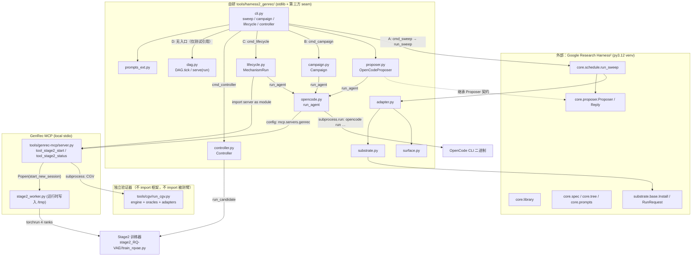
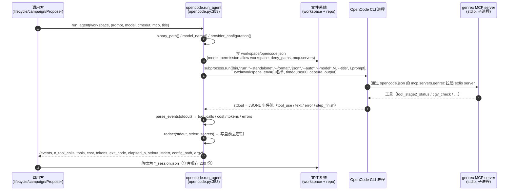

# 调用图：四条互不相同的链路

**Issue #113 · 只读审计 · `main` = `f6d78b68` · 2026-10-23T14:04:31Z**

本文件逐函数给出路径、函数名、行号与分支条件。四条链**分开列**，不合并：

| 链 | 入口 | 编排者 | 是否经过原版 Harness² | 是否调用 OpenCode |
|---|---|---|:--:|:--:|
| **A** | `cli sweep` | 原版 `harness2.core.schedule` | **是**（唯一） | 是（经 `Proposer` 协议） |
| **B** | `cli campaign` | 自研 `campaign.Campaign` | 否 | 是（直接） |
| **C** | `cli lifecycle` | 自研 `lifecycle.MechanismRun` | 否 | 是（直接） |
| **D** | `#112` DAG | **无生产编排者**（交互式协调者驱动） | 否 | 否（0 次会话） |

链 A 与链 B/C 只在**一个类**上相交：`OpenCodeProposer`（`proposer.py:183`），它同时是框架的
`Proposer` 实现，也是 `run_agent` 的一个调用点。

---

## 0. 架构图（全仓库视角）



实线 = 本次审计以代码或运行工件证实的调用；虚线 = 类型/契约继承。

---

## 1. 链 A：`cli sweep` —— 唯一把控制权交给原版框架的路径

```
cli.main                                   cli.py:723
└─ cmd_sweep(args)                          cli.py:90
   ├─ if args.offline:                      cli.py:97
   │    ├─ channel = OFFLINE_CHANNEL        cli.py:38 (ChannelSpec("opencode","local/deterministic"))
   │    └─ prop  = ScriptedProposer(...)    cli.py:99   → 无子进程、无模型
   └─ else:                                 cli.py:101
        ├─ model = args.model or $HARNESS2_OPENCODE_MODEL
        │        or opencode.model_name()    cli.py:102-103 → opencode.py:136
        ├─ channel = ChannelSpec("opencode", model)   cli.py:103
        ├─ prop = OpenCodeProposer(channel, audit_dir=…, model=…, timeout=…,
        │                           repo_root=REPO_ROOT)      cli.py:104
        │      → 唯一构造点（全仓库 grep 只有这一处）
        └─ adapter = GenrecAdapter(REPO_ROOT, runs_root, task_ids=…, channel=…,
        │                           harness_root=…)          cli.py:112
   └─ run_sweep(adapter, prop, runs_root, k, modes, split, seed, tag, workers, only_domains)
                                                  cli.py:119 → cli.py:60
      └─ SCHED.run_sweep(k, adapter=…, prop=…, runs_root=…, library_root=…,
                         split=…, modes=…, seed=…, tag=…, domain_parallel=workers,
                         only_domains=…, pool_policy="finals")        cli.py:74
         │                        ↑ 第三方 harness2.core.schedule（py3.12 venv 内）
         │                        ↓ 框架内部实现本次未读（仅用 seam）
         ├─ library_root = LIB.root_for(runs_root/"library", benchmark=…, k=…, variant=…)
         │                                              cli.py:42 → core.library
         └─ 对每个 task 调用框架的 Proposer 协议：prop.call(mission, context_dir, label)
                └─ OpenCodeProposer.call(mission, context_dir, label, **kwargs)  proposer.py:216
                   ├─ workspace = tempfile.mkdtemp(prefix="h2-proposer-")      proposer.py:218
                   ├─ _copy_context(context, workspace/"context")              proposer.py:224
                   ├─ prompt = self._prompt(mission, system)                   proposer.py:225 → :256
                   ├─ mcp = opencode.mcp_server_block(self.repo_root)          proposer.py:228 → opencode.py:234
                   ├─ result = opencode.run_agent(workspace, prompt, model=…, timeout=…,
                   │                                mcp=mcp, title=label)       proposer.py:229
                   ├─ self._audit(label, mission, result)                      proposer.py:236 → :272
                   └─ return Reply(label, text, ok, cost_usd, wall_s, attempts=1,
                                  channel="opencode", workspace=…)              proposer.py:245-255
```

**分支条件**：`--offline` 走 `ScriptedProposer`（零子进程、零模型）；否则才可能拉起 OpenCode。

**读盘**：`runs_root/sweep.json`（`cmd_sweep` 末尾写），`runs_root/"adapt"` 是框架的运行目录。

---

## 2. 链 B：`cli campaign` —— 自研编排，直连 OpenCode

```
cli.main                                    cli.py:723
└─ cmd_campaign(args)                        cli.py:259
   ├─ config = CampaignConfig.load(Path(args.config))    cli.py:262
   └─ state = execute(config)                            cli.py:263 → campaign.py:973
      └─ Campaign(config)                                campaign.py:113
         ├─ ideate(round_index, evidence)                campaign.py:184
         │    └─ opencode.run_agent(...)                 campaign.py:208   ← 直连，不经框架
         ├─ run_arm(proposal, round_index=…)             campaign.py:272
         │    ├─ implementation = opencode.run_agent(...) campaign.py:316   ← 写实现
         │    └─ repair = opencode.run_agent(...)         campaign.py:360   ← 失败后修复
         ├─ _run_arms(...)                               campaign.py:788
         └─ evaluate_harness(campaign)                   campaign.py:845
              └─ opencode.run_agent(...)                 campaign.py:897   ← 评估
```

**要点**：`campaign.py` 的 import 段（campaign.py:25–37）只有 `subprocess`、`ideation`、
`opencode`、`lifecycle`、`proposal` —— **没有 `harness2`**。多轮机制、冷启动与失败反馈由
`Campaign` 自己控制，不经框架。

---

## 3. 链 C：`cli lifecycle` —— 单机制全生命周期

```
cli.main                                    cli.py:723
└─ cmd_lifecycle(args)                       cli.py:194
   ├─ proposal = load_proposal(Path(args.proposal))          cli.py:198
   ├─ config = LifecycleConfig(...)                          cli.py:199
   └─ run = MechanismRun(config, proposal)                  cli.py:213 → lifecycle.py:144
      ├─ run.freeze_proposal()              lifecycle.py:199  （写 manifest / proposal_sha256）
      ├─ run.implement()                    lifecycle.py:224
      │    └─ opencode.run_agent(...)       lifecycle.py:233
      ├─ run.verify()                       lifecycle.py:270
      │    └─ subprocess.run(...)            lifecycle.py:328  （独立校验，非 OpenCode）
      ├─ if not verify.ok: run.repair()     lifecycle.py:387
      │    └─ opencode.run_agent(...)       lifecycle.py:396
      ├─ run.probe()                        lifecycle.py:440
      │    └─ subprocess.run(...)            lifecycle.py:458
      ├─ run.admit()                        lifecycle.py:502  （写 admission.json，绑定 tree_digest）
      ├─ run.stage2()                       lifecycle.py:546
      │    ├─ server = self._mcp_server()   lifecycle.py:739  （import tools/genrec-mcp/server.py 为模块）
      │    ├─ result = server.tool_stage2_start(source_dir=arm_tree, admission=…)  lifecycle.py:563
      │    └─ final = self._await_stage2(server)            lifecycle.py:749
      │         └─ server.tool_stage2_status(...)           lifecycle.py:754（60 s 轮询，6 h 预算）
      └─ run.evaluate()                     lifecycle.py:628
           └─ subprocess.run([PROJECT_PYTHON, tools/mvg/er_eval.py, --sid, --out])
                                                       lifecycle.py:649
```

**要点**：`stage2` 走 **MCP server 的 in-process import**（`lifecycle.py:739`），不是 stdio 子进程；
`evaluate` 走 `tools/mvg/er_eval.py`（**不是** `analysis.py`）。

---

## 4. 链 D：`#112` DAG —— 记账层，无执行体

```
（无生产入口；仓库内仅 tests/test_dag.py 构造 DAG）
DAG.__init__(root, resource_limits=…, lease_ttl=300)     dag.py:187
├─ add(task|Iterable[Task])                               dag.py:250   （落 state.json）
├─ tick(owner=…, resource=…, limit=…)                    dag.py:349
│   ├─ 1. 回收过期租约 → reclaim / blocked                 dag.py:364-379
│   ├─ 2. WAITING_AUTHORISATION 且已授权 → READY           dag.py:380-384
│   ├─ 2b. READY 但依赖未全 DONE → 降级/关闭（本次新加）    dag.py:386-405
│   ├─ 3. 派发：状态置 RUNNING、记 lease_owner、attempts+1  dag.py:406-425
│   └─ 返回 {dispatched, reclaimed, deferred, idle, rounds, idle_ticks}
├─ complete(task_id, owner, artifacts=…, detail=…, metrics=…)   dag.py:467
│    └─ 若 requires.metric 不满足 → 抛 SchedulerError（门不可被“完成”）  dag.py:491
├─ fail(task_id, owner, error)                            dag.py:510
├─ set_status(task_id, status, reason)                    dag.py:531
├─ serve(run: Callable[[Task], None], owner=…, …)         dag.py:549
│    ├─ tick(limit=1) → 取出 1 个任务                      dag.py:561
│    ├─ 起心跳线程 beat() → self.heartbeat(task_id, owner) dag.py:571-576
│    ├─ run(task)  ← **调用方提供的回调**（仓库内无实现）  dag.py:579
│    └─ complete / fail 收尾                               dag.py:580-583
└─ reserve(candidate, stage, seed=42, protocol=…)         dag.py:591
     └─ 原子写 reservations.json，rounds += 1               dag.py:600-617
```

**`serve` 不会创建 OpenCode Agent**：它只调用传入的 `run(task)`；`dag.py` 的 import 段
（dag.py:36–47）没有 `opencode`、没有 `subprocess`。

**#112 的实际驱动方式**（运行证据）：`results/hyperbolic_research_runs/issue112/dag/events.jsonl`
共 19 条 `dispatched`，`owner` 全部为 `coordinator`；71 条 `idle_tick`；1 条 `reserved`
（`hyp_product_l1_quantiser|stage2|42|stage2-cold-3000`）。**没有任何 worker 进程**。

---

## 5. 时序图：一次**已被证明**的 OpenCode Agent 调用

取有运行记录的一次：`results/harness3_runs/candidates/reference_codebook_geometry_preservation/repair_session.json`。



**无法证明的步骤**（本图以注释标出）：OpenCode CLI **内部**如何调度工具、如何保存会话、
是否复用 OAuth 凭证——这些在第三方二进制内部，本次未读；`stdout` 中除已解析字段外的内容
只以原文形式保留在会话 JSON 里。

---

## 6. 交叉引用：谁在什么时候真的执行了什么

| 环节 | 链 A | 链 B | 链 C | 链 D（#112） |
|---|---|---|---|---|
| 生成机制 | 框架 `proposer.call` | `ideate` → `run_agent` | 无（人给 proposal） | **无会话**（工件为准） |
| 写实现 | 框架把回复当 workspace 读 | `run_arm` → `run_agent` | `implement` → `run_agent` | **人工改 sealed tree** |
| 独立校验 | `substrate.py` 跑 verifier | `oracle.py` | `verify` → `subprocess` | `tools/cgv/run_cgv.py` |
| 训练 | 不含 | `run_candidate`（经 candidate_run） | `stage2` → MCP → worker → torchrun | **MCP `stage2_start`**（`xd://mcp__genrec_stage2_start`） |
| 评测 | 不含 | `evaluate_harness` → `run_agent` | `evaluate` → `tools/mvg/er_eval.py` | `tools/harness2_genrec/analysis.py`（人工调用） |
| 记账 | 框架自己的 `runs/` | `campaign` state.json | `manifest.json` | `dag/state.json` + 手工 `campaign_dag.json`（**无代码读取**） |

---

## 7. 可核对的行号索引

| 符号 | 位置 |
|---|---|
| `SCHED.run_sweep` 调用 | `tools/harness2_genrec/cli.py:74`（唯一） |
| `OpenCodeProposer(...)` 构造 | `tools/harness2_genrec/cli.py:104`（唯一） |
| `OpenCodeProposer.call` | `tools/harness2_genrec/proposer.py:216` |
| `opencode.run_agent` 定义 | `tools/harness2_genrec/opencode.py:353` |
| argv 拼装 | `tools/harness2_genrec/opencode.py:406-420` |
| `subprocess.run`（OpenCode） | `tools/harness2_genrec/opencode.py:425-431` |
| `parse_events` | `tools/harness2_genrec/opencode.py:293` |
| `build_config`（workspace 权限/MCP） | `tools/harness2_genrec/opencode.py:249` |
| `mcp_server_block` | `tools/harness2_genrec/opencode.py:234` |
| `Campaign.ideate` / `run_arm` / `evaluate_harness` | `tools/harness2_genrec/campaign.py:184 / 272 / 845` |
| `MechanismRun.implement` / `verify` / `repair` / `probe` / `admit` / `stage2` / `evaluate` | `tools/harness2_genrec/lifecycle.py:224 / 270 / 387 / 440 / 502 / 546 / 628` |
| `MechanismRun._mcp_server` / `_await_stage2` | `tools/harness2_genrec/lifecycle.py:739 / 749` |
| `DAG.tick` / `serve` / `reserve` / `complete` / `fail` | `tools/harness2_genrec/dag.py:349 / 549 / 591 / 467 / 510` |
| `Controller.phase_train` → `run_candidate` | `tools/harness2_genrec/controller.py:1089 → 1066` |
| `tool_stage2_start` | `tools/genrec-mcp/server.py:1189` |
| `run_cgv_verification` | `tools/genrec-mcp/server.py:2066` |
| `CGV_RUNNER` / `CGV_PY` / `CGV_TIMEOUT_S` | `tools/genrec-mcp/server.py:1943 / 1945 / 1946` |
| `HARNESS_DIR` / `STATE_DIR` | `tools/genrec-mcp/server.py:73 / 70` |
