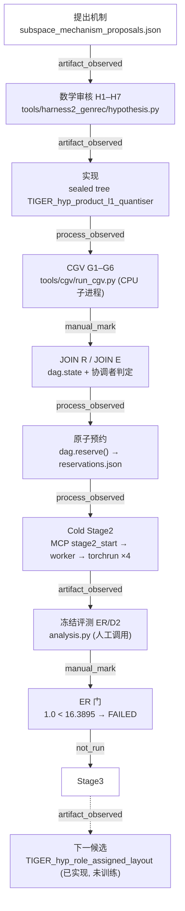

# 机制探索全链路溯源：以 #112 的 `hyp_product_l1_quantiser` 为例

**Issue #113 · 只读审计 · `main` = `f6d78b68` · 2026-10-23T14:04:31Z**

本文件把一次「提出机制 → 训练 → 判定」的真实链路逐步展开，并对每一步标注**证据类型**：

| 标注 | 含义 |
|---|---|
| `process_observed` | 有 pid / worker 状态 / 日志 / 指标流等进程级证据 |
| `artifact_observed` | 有产物文件，但**没有**调用它的进程证据 |
| `manual_mark` | 协调者在事后用状态机 API 标记的结果 |
| `not_run` | 该步骤明确未发生 |

---

## 0. 链路图

---

## 1. 逐步时间线（UTC）

| # | 时刻 (UTC) | 步骤 | 真实触发者 | 证据类型 | 工件 / 位置 |
|---|---|---|---|---|---|
| 1 | 2026-10-23 ≤ 16:15 | 研究 Agent L/A/M 产出提案族 | **不可考证** | `unknown` | `results/hyperbolic_research_runs/subspace_111/`（提交 `1484671d`）；**无会话记录** |
| 2 | 2026-10-23 16:15–18:31 | H1–H7 几何可行性、独立 oracle、先验检索 | 交互式协调者 | `artifact_observed` | `subspace_geometry_review.json`、`prior_art_map.md`、`source_search_log.jsonl` |
| 3 | 2026-10-23 18:31 | 提案冻结 + 七组声明 | 交互式协调者 | `artifact_observed` | `issue112/spec_hyp_product_l1_quantiser.json`（`spec_sha256` 记录在 `cgv_*.json`） |
| 4 | 2026-10-23 18:31 后 | 实现（sealed tree） | 交互式协调者**手改代码** | `artifact_observed` | `stage2_RQ-VAE/TIGER_hyp_product_l1_quantiser/`（提交 `f30cb5b7` 等） |
| 5 | 2026-10-23 ~19:00 | CGV G1–G6 全过 | `tools/cgv/run_cgv.py`（`genrec_env_v2` py3.9，CPU） | `process_observed` | `issue112/cgv_hyp_product_l1_quantiser.json`（G5 的池化梯度偏差 1.490e-08，rank 逐位一致） |
| 6 | 2026-10-23 ~19:30 | parity 检查 + JOIN E | 交互式协调者 + `tools/harness2_genrec/implementation_parity.py` | `artifact_observed` | `issue112/implementation_parity.json`、`join_e_hyp_product_l1_quantiser.json` |
| 7 | 2026-10-23 20:53:47 | **原子预约**（唯一的 round） | `dag.reserve()` | `process_observed` | `issue112/dag/reservations.json`：`hyp_product_l1_quantiser\|stage2\|42\|stage2-cold-3000` |
| 8 | 2026-10-23 20:53:47 | 授权记录 | `dag.authorise("gpu", "operator-2026-10-23", …)` | `process_observed` | `events.jsonl` 的 `authorised` / `authorisation_released` |
| 9 | 2026-10-23 21:19 → 21:41 | **DAG 19 次派发、71 次空转**（只记账） | `dag.tick(owner="coordinator")` | `manual_mark` | `issue112/dag/events.jsonl`（**全部 owner=coordinator，无 worker 进程**） |
| 10 | 2026-10-23 23:12:21 | **MCP 启动冷跑** | `xd://mcp__genrec_stage2_start` → genrec MCP `tool_stage2_start` | `process_observed` | `~/.cache/genrec-mcp/stage2__TIGER_hyp_product_l1_quantiser.json`：pid 3755994、cmd、cwd、4 卡探测 |
| 11 | 2026-10-23 23:12 → 23:19 | **CGV 复跑 + 1-epoch 24 步 DDP 冒烟** | `server.run_cgv_verification` → `stage2_worker.py`（`/tmp/genrec-mcp/`） | `process_observed` | `/tmp/genrec-mcp/smoke_TIGER_hyp_product_l1_quantiser.log`：`SMOKE_SUMMARY{passed:true}` + `SMOKE_PASS` |
| 12 | 2026-10-23 23:19:17 → 23:31:36 | **冷跑 3000 epoch（4 卡 torchrun）** | 训练器自 fork `torchrun --nproc_per_node=4` | `process_observed` | `logs/hyp_factor_nce_c1/train_migrated.log`（3003 行指标）、`training_metrics.jsonl`（3003 条，739.063 s） |
| 13 | 2026-10-23 23:31 | 导出 SID | 训练器 | `artifact_observed` | `results/stage2_RQ-VAE/TIGER_hyp_product_l1_quantiser/{sids_for_hgrec.npy,item_sids.json,rqvae_best.pth}` |
| 14 | 2026-10-23 23:41 → 23:43 | 冻结 ER/D2 评测 | 交互式协调者调 `analysis.py` | `artifact_observed` | `issue112/evaluation_hyp_product_l1_quantiser.json`：ER **1.0**（对照 16.334505666275888） |
| 15 | 2026-10-23 23:43 | ER 门判定 | `dag.complete` 被**拒绝** → `dag.fail` | `manual_mark` | `events.jsonl`：`the frozen gate FAILED …`（DAG 自身在 `dag.py:491` 拒绝用失败测量 complete） |
| 16 | 2026-10-23 23:43 | **Stage3** | — | `not_run` | 协议禁止；`stage3` 任务状态置 `blocked` |
| 17 | 2026-10-23 23:44 → 2026-10-24 | 下一候选（角色化布局）实现 + 24 步冒烟 | 交互式协调者 | `artifact_observed` | `stage2_RQ-VAE/TIGER_hyp_role_assigned_layout/`、`issue112/layout_smoke.json`；最终一次冒烟（残差轨迹改为角色感知后）实测 level 0/1/2 = 249/256/**256** 码，最大 cell 271/316/152 |
| 18 | 2026-10-24 | 审计（本次） | 交互式协调者 | `artifact_observed` | `results/architecture_audits/opencode_harness2_callchain/` |

> 时刻说明：本机本地时区为 UTC+11，表内统一用 UTC；`logs/` 与 `training_metrics.jsonl` 里的
> `at` 字段也是 epoch 秒。

---

## 2. 「谁真正触发了各步骤」的逐项判定

| 步骤 | 是「Agent 实际执行」还是「人工标记」？ | 依据 |
|---|---|---|
| 提出机制（L/A/M） | **无法判定**：只有工件，无会话 | 230 份会话里 0 份涉及这些 id |
| 实现 | **人工**（手改 sealed tree） | 树里没有 `implement_session.json`；同期的 153 份 `implement_*_session.json` 全部属于 c1/c106/c107 臂 |
| CGV 六门 | **机器执行**（CPU 子进程） | `cgv_*.json` 的 `trainer_sha256`/`spec_sha256`/`gates` 六项 |
| JOIN R / JOIN E | **人工判定 + DAG 记账** | `join_e_*.json` 是协调者写的；DAG 只记录 `done` 事件 |
| 原子预约 | **机器执行**（`dag.reserve` 原子写） | `reservations.json` 一次写入，`rounds=1` |
| 冷跑 | **机器执行**（MCP → worker → torchrun） | pid、cmd、smoke 日志、3003 条指标 |
| ER 评测 | **人工调用**（`analysis.py`） | `evaluation_*.json` 无 session/进程字段 |
| ER 门 | **人工标记**（且被 DAG 机制阻止误记为 done） | `events.jsonl` 的 `failed` 事件 |
| Stage3 | **未运行** | 无 Stage3 产物、无 `stage3` 任务完成事件 |

---

## 3. 「调度器计数 ↔ 真实执行」的一一对应检查

| 计数器 | 值 | 与真实执行是否一一对应 |
|---|---|---|
| `dag.state["dispatched"]` | 19 | **否**：19 次派发里只有 1 次对应真实 GPU 作业（`hyp_busemann_boundary:stage2` 那次是**误派发**，该族已被证伪，且它只拿到租约、没起进程）；`hyp_product_l1_quantiser:stage2` 的租约是**事后手工写入**的（`lease_owner="genrec-mcp:stage2_start"`），事件流里没有它的 `dispatched` |
| `dag.state["rounds"]` | 1 | **是**：`reservations.json` 恰好 1 条，与唯一的官方冷跑对应 |
| `events.jsonl` 的 `done` | 7 | **否**：7 次 `done` 是协调者对**已完成工作**的补记（其中 `stage2` 的 detail 明确写着「the cold seed-42 3000-epoch run completed (23:19-23:41)」——这是**事后**描述，不是过程观测） |
| `campaign_dag.json` 的 `dispatched_total` / `status_counts` | 见文件 | **否**：该文件**没有任何代码读取**（grep 全仓库无引用），是手工台账；它与 `dag/state.json` 的任务数不同（32 vs 29），两者从未同步 |
| OpenCode 会话数 | 230 | **是**（每一份都有 argv/退出码/token）；但**与本轮机制探索无关**：0 份涉及 #111/#112 的候选 |
| GPU 作业数 | 1 | **是**：唯一的 `torchrun` 4 卡作业，23:19–23:31 |

**结论**：`dispatched` / `done` 这类计数在本 campaign 中**不能**当作「有 Agent/进程执行过」的证据；
唯一可以当作官方科学轮次计数的是 `reservations.json`。

---

## 4. 第二候选 `hyp_role_assigned_layout` 的状态（已实现、未训练）

| 项 | 值 | 证据类型 |
|---|---|---|
| 树 | `stage2_RQ-VAE/TIGER_hyp_role_assigned_layout/`（自已批准树的逐字节 fork） | `artifact_observed` |
| 机制 | level 2 量化行为因子；level 0/1 保留宿主残差链；重构只用 level 0+1 | `code_verified` |
| 冒烟 | 24 步真实入口（最终一次，残差轨迹角色感知）：level 0 = **249** 码 / 最大 cell 271（1.10%）；level 1 = **256** / 316（1.29%）；**角色层 256 全用 / 最大 cell 152（0.62%）**；三层均过 `partition_degeneracy` 门 | `process_observed`（`/tmp/role_layout_smoke/sids_for_hgrec.npy`，复核命令见 `evidence_index.json` E26） |
| CGV | G1–G4 + G6 通过；**G5 未通过**（executor 声明装配贡献为 0，多卡门需要带梯度的项） | `process_observed` |
| 官方冷跑 | **未运行** | `not_run` |
| 预约 | 无 | `not_run` |

---

## 5. 复盘环节（#111/#112 的「失败复盘 → 下一机制」）

| 复盘产物 | 内容 | 证据类型 |
|---|---|---|
| `issue112/refutation_hyp_product_l1_quantiser.md` | 该候选被自己的冷跑证伪；根因是 level-0 分配退化为半径比较（行范数最小的码字对每个物品都是 argmin）；两个对照排除了切空间缩放与码本行范数的影响 | `artifact_observed` |
| `issue112/q7_measured_obstruction.md` | 冻结协议内的不可行性证明：第三个 token 的信息量由训练好的码本决定（格内散布 ÷ L3 码本间距 = 0.7895），改度量无效（Möbius 链 0.9208 → 0.9263） | `artifact_observed` |
| `issue112/partition_degeneracy.py` + 5 测试 | 暴露上述失败后补的门：每层须用 >16 个码、任一 cell 不得超过目录四分之一 | `code_verified` |
| `issue112/layout_feasibility.json` | 下一候选的可行性：行为因子 1.3724 码/格、75.06% 单码格（残差 1.0969 / 92.08%） | `artifact_observed` |
| `issue112/layout_prior_art.json` | 下一候选的先验检索：8 条查询、662 篇语料内无先验 | `artifact_observed` |

**复盘→下一机制的衔接是真实的**：不可行性证明指出「只能改每层的含义或 L0 尾部」，于是有了
角色化布局；该布局的可行性先量后实现；实现后冒烟过门但**未获授权训练**。

---

## 6. 本链路中「未运行 / 无法证明」的部分（明确留白）

- **Stage3**：未运行（ER 门失败，协议禁止）。
- **G_H1 探针**：本轮未运行（评测在 ER 门处终止）。
- **Agent L/A/M/I 的会话**：无法证明。
- **交互式协调者的具体命令序列**：shell 历史不可得，只能由工件时间戳与 DAG 事件反推。
- **第三方框架内部的调度实现**：未读（仅用本仓库 import 的 7 个 seam）。
